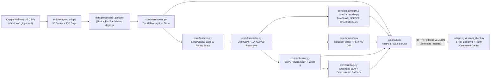

# StockPulse AI — Probabilistic Demand Forecasting, XAI Studio & Constrained Inventory Optimization

> **Portfolio Flagship Project 5** by **Maria Ali** ([`mariahunzai1`](https://github.com/mariahunzai1))  
> **100% \$0 CPU-First Stack** · Real **Kaggle Walmart M5** Dataset (`CA_1`, `TX_1`, `WI_1`) · DuckDB · LightGBM P10/P50/P90 · TreeSHAP & XAI Studio · IsolationForest + PSI Drift · SciPy HiGHS MILP · FastAPI + Streamlit

---

## Executive Overview

**StockPulse AI** is an end-to-end decision-intelligence platform that transforms raw daily retail POS history into **probabilistic demand quantiles (`P10`/`P50`/`P90`)**, **explainable AI attributions**, **automated demand-shock & distribution-drift alerts**, and **budget-constrained Mixed-Integer Linear Programming (MILP) purchase orders**.

Instead of relying on single-point forecasts and heuristic rules of thumb that either tie up working capital or trigger stockouts during demand spikes, StockPulse AI couples calibrated quantile forecasting with a multi-scenario HiGHS MILP optimizer and a strictly grounded executive briefing copilot.

---

## System Architecture



---

## Real Walmart M5 Dataset & Leakage-Free Engineering

- **Curated Scope:** 3 regional Walmart stores spanning all 3 M5 states (`CA_1`, `TX_1`, `WI_1`) × 10 active SKUs across `FOODS`, `HOBBIES`, and `HOUSEHOLD` over the final **730 days (`d_1212`–`d_1941`, `2014-05-24` to `2016-05-22`)** = **21,900 daily records**.
- **Curated Artifacts:** `data/processed/m5_curated_sales.parquet` (21,900 rows) and `data/processed/m5_sku_policies.parquet` (30 operational SKU policy records) ship directly with the repository for zero-setup cloning and Streamlit Community Cloud deployment.
- **Zero Target Leakage:** All lags (`lag_1`, `lag_7`, `lag_14`, `lag_28`) and rolling statistics (`rolling_mean_7`, `rolling_std_7`, `rolling_mean_28`, `rolling_zero_rate_28`) shift strictly past-only (`shift(>=1)`) before aggregation, `price_vs_item_avg` uses causal expanding windows, and validation holds out the exact official 28-day horizon (`2016-04-25` to `2016-05-22`, 840 rows).

---

## Verified Backtesting Benchmark (`eval/benchmark.py`)

### 1. Demand Forecasting (28-Day Autoregressive Rollout across 30 Store-SKUs)

| Model | WAPE | MAE | RMSE | Pinball P10 | Pinball P50 | Pinball P90 | 80% PI Coverage |
| --- | ---: | ---: | ---: | ---: | ---: | ---: | ---: |
| 7-Day Seasonal Naive | 0.3875 | 4.283 | 7.894 | 0.8846 | 2.1417 | 1.0480 | 72.38% |
| **LightGBM Quantile (P10/P50/P90)** | **0.3222** | **3.561** | **6.411** | **0.6889** | **1.7805** | **0.9803** | **80.60%** |

- **`+16.86%` WAPE improvement** over 7-Day Seasonal Naive (`FOODS`: `0.2297` vs. `0.3055`; `HOUSEHOLD`: `0.5411` vs. `0.5774`; `HOBBIES`: `0.6554` vs. `0.6897`).
- **`80.60%` empirical 80% prediction-interval coverage** on strictly out-of-time autoregressive rollouts.

### 2. Constrained Inventory Optimization (`SciPy HiGHS MILP` vs. 14-Day Rule-of-Thumb)

| Scenario | MILP Cost (\$) | Baseline Cost (\$) | Savings (\$) | Cost Reduction | MILP Service | Baseline Service | Baseline Cap Violation |
| --- | ---: | ---: | ---: | ---: | ---: | ---: | :---: |
| Nominal | \$46.92 | \$284.00 | \$237.08 | **+83.48%** | 100.00% | 95.77% | No |
| +30% Demand Surge | \$62.37 | \$538.23 | \$475.86 | **+88.41%** | 99.99% | 91.51% | No |
| +50% Lead-Time Delay | \$67.08 | \$470.21 | \$403.13 | **+85.73%** | 99.99% | 92.61% | No |
| Tight Capital Cap (\$2,000 / 900u) | \$274.23 | \$284.00 | \$9.77 | **+3.44%** | 90.34% | 95.77% | **Yes** |

---

## Explainable AI (`XAI`) Studio & Grounded Briefing Copilot

- **Multi-Quantile Tail-Risk Attribution (`GET /xai/tail-risk/{store_id}/{item_id}`):** Exact `shap.TreeExplainer` decomposition across `P10`, `P50`, and `P90` models plus `Spread SHAP (P90 - P10)` identifying what widens or narrows demand uncertainty.
- **Partial Dependence & ICE Curves (`GET /xai/pdp/{feature_name}`):** Global PDP overlaid on sampled SKU ICE trajectories across `sell_price`, `price_vs_item_avg`, `rolling_mean_7`, and `rolling_zero_rate_28`.
- **Actionable Counterfactual Search (`POST /xai/counterfactual`):** Searches bounded `sell_price` (`-25%`..`+25%`) and `lead_time_days` (`-50%`..`0%`) interventions for target demand shifts or stockout elimination.
- **MILP Decision & Constraint Audit (`POST /xai/decision-audit`):** Per-SKU `net_economic_benefit`, `stockout_risk_ratio`, `moq_binding`, and `budget_or_capacity_constrained` flags with natural-language rationales.
- **Grounded Executive Briefing (`POST /briefing`):** Supports local **Ollama** (`llama3.2:3b`) and **Google AI Studio** (`gemini-3.5-flash-lite`) via OpenAI-compatible `LLM_BASE_URL` / `LLM_API_KEY` / `LLM_MODEL`, with automatic **offline deterministic fallback** so cloud deployments never fail without paid keys.

---

## Quickstart

### 1. Environment Setup (Python 3.11–3.13)

```powershell
py -3.13 -m venv .venv
.venv\Scripts\python.exe -m pip install -r requirements.txt
```

### 2. Single-Command Launch (Local & Streamlit Community Cloud)

Because `data/processed/*.parquet` is tracked in Git and `ui/api_client.py` automatically spawns `uvicorn api.main:app` in the background when no local server is running, launching the entire full-stack platform takes **one command**:

```powershell
.venv\Scripts\streamlit.exe run ui/app.py
```

*(Optional separate API launch: `.venv\Scripts\uvicorn.exe api.main:app --host 127.0.0.1 --port 8000`)*

### 3. Re-Run ETL, Benchmark & Offline Verification Suite

```powershell
# Rebuild curated Parquet files from raw Kaggle M5 CSVs (if data/raw/* is present)
.venv\Scripts\python.exe scripts/ingest_m5.py

# Regenerate reproducible evaluation tables & JSON
.venv\Scripts\python.exe -m eval.benchmark

# Run full offline pytest verification suite
.venv\Scripts\python.exe -m pytest -v
```

### 4. Dual-LLM Configuration (`.env`)

Copy `.env.example` to `.env` to enable live LLM executive briefings (leave `LLM_API_KEY` blank to run in `deterministic_fallback` mode):

- **Local Ollama (`\$0`):** `LLM_BASE_URL=http://localhost:11434/v1`, `LLM_API_KEY=ollama`, `LLM_MODEL=llama3.2:3b`
- **Google AI Studio:** `LLM_BASE_URL=https://generativelanguage.googleapis.com/v1beta/openai/`, `LLM_API_KEY=<your-key>`, `LLM_MODEL=gemini-3.5-flash-lite`

---

## Repository Structure

```text
├── .agents/rules/           # Engineering & zero-leakage governance rules
├── .streamlit/config.toml   # Dark executive Streamlit theme
├── api/main.py              # FastAPI backend + lifespan orchestration
├── core/                    # DuckDB, features, LightGBM, SHAP, XAI Studio, IsolationForest, HiGHS MILP, Briefing
├── data/processed/          # Tracked curated Walmart M5 Parquet tables
├── eval/                    # Reproducible backtesting benchmark & results
├── scripts/ingest_m5.py     # Raw Walmart M5 CSV -> curated Parquet ETL
├── tests/                   # Offline pytest suite (warehouse, features, ML/MILP, API, XAI, UI isolation)
└── ui/                      # Strictly HTTP-decoupled Streamlit + Plotly Command Center
```
